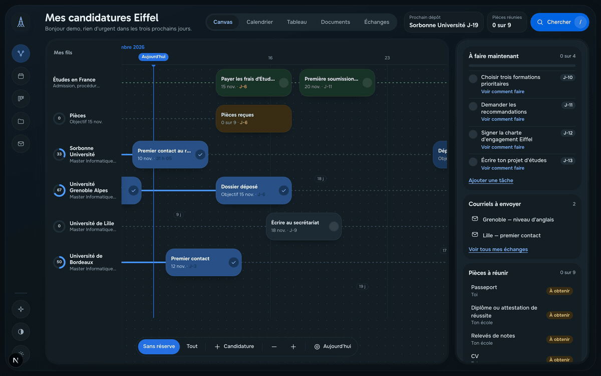
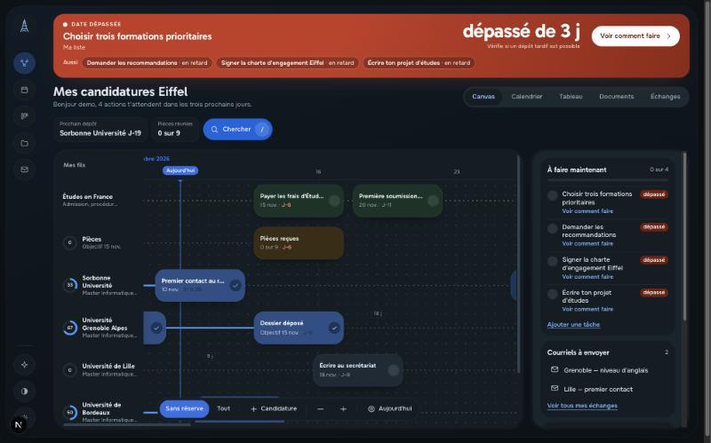
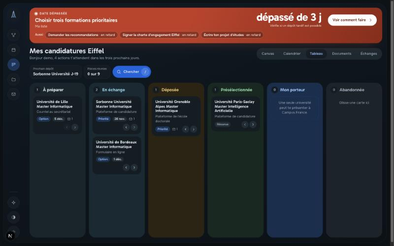
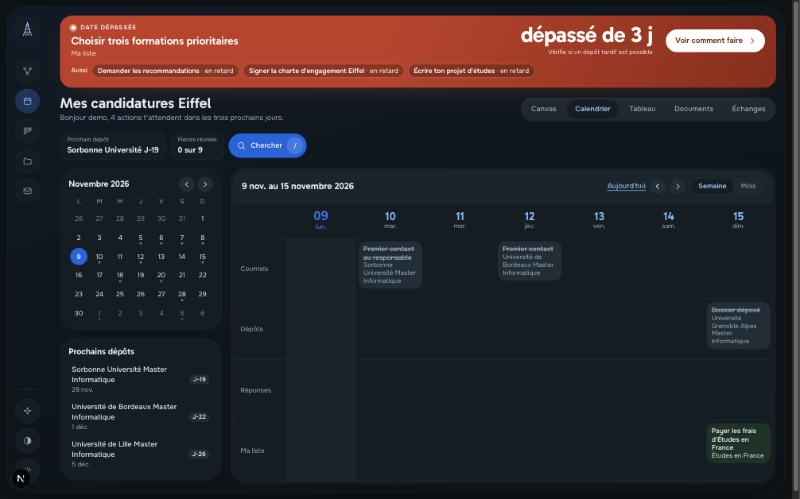
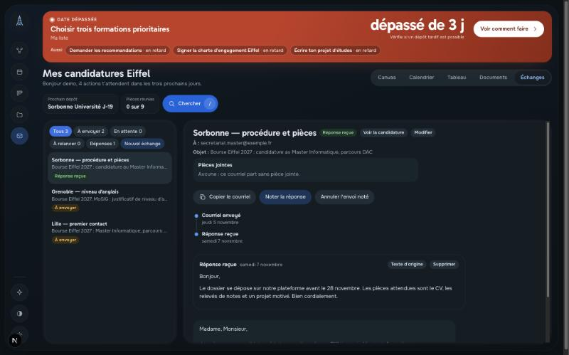
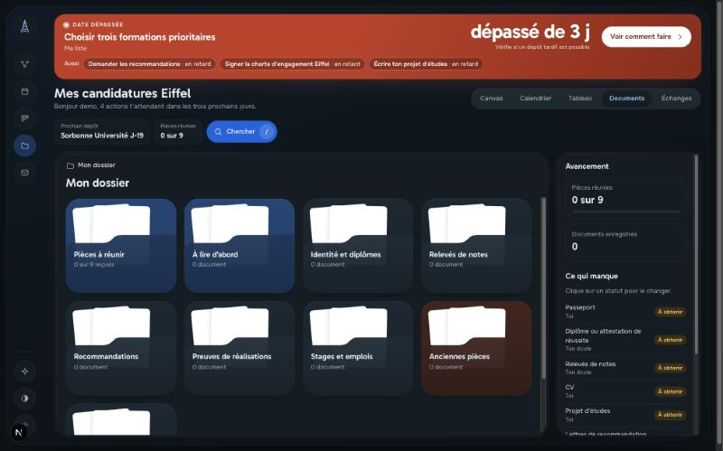
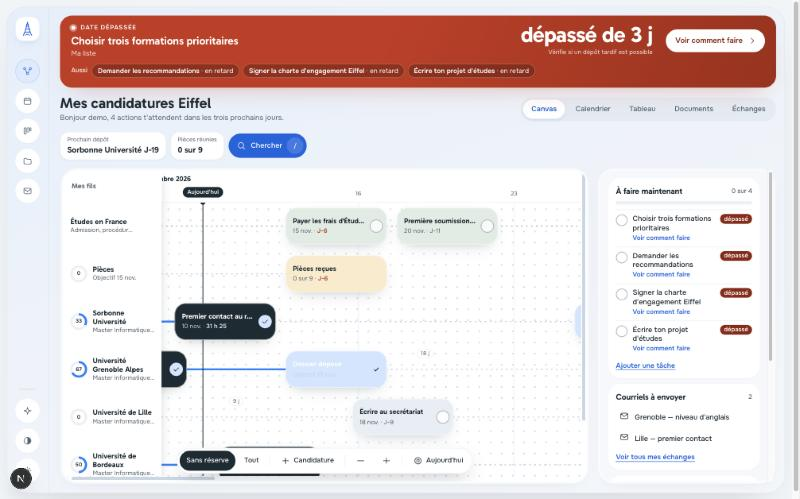
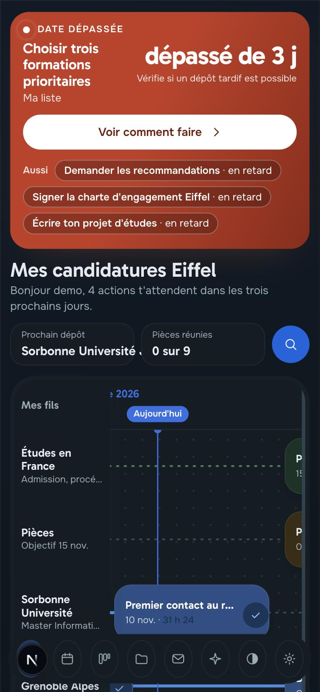

# Parcours

**Un espace privé pour suivre ses candidatures — universités, bourses, emplois.** Chaque personne invitée se connecte et retrouve ses échéances, ses pièces, ses courriels et ses documents. Personne d'autre n'y a accès, pas même l'administrateur.

[](https://github.com/spyder20052/parcours/actions/workflows/ci.yml)
[](LICENSE)
[](https://nextjs.org)
[](#sécurité)
[](#accessibilité)



Le code est ouvert sous licence MIT. Tu peux l'héberger pour toi et tes proches, l'adapter à ton parcours depuis l'application, ou le modifier avec Claude Code. *(English summary at the end of this file.)*

> Toutes les captures ci-dessous proviennent d'un espace de démonstration peuplé du modèle « Bourse Eiffel 2027 ». Les universités citées sont des exemples publics ; aucune donnée personnelle n'est utilisée.

## Aperçu

### Canvas — chaque candidature est un fil posé sur le temps

Les échéances passées remontent en haut, en rouge : l'application met en avant ce qui est en retard et propose « comment faire ».



| Tableau à colonnes | Calendrier semaine et mois |
|---|---|
|  |  |
| **Échanges — courriels et réponses** | **Documents et pièces à réunir** |
|  |  |

| Thème clair | Sur téléphone |
|---|---|
|  |  |

## Ce que fait l'application

- **Cinq vues** sur les mêmes données :
  - **Canvas** : chaque candidature est un fil posé sur le temps.
  - **Calendrier** : vues semaine et mois.
  - **Tableau** : colonnes à glisser-déposer.
  - **Documents** : dossiers avec aperçu des PDF.
  - **Échanges** : courriels à envoyer, relances à sept jours, réponses collées et remises en forme.
- **Modes d'emploi** sur chaque étape, tâche et pièce : pourquoi, comment, et des boutons qui ouvrent le bon document, le bon lien ou le bon courriel.
- **Modèles de parcours** au premier lancement. Le dépôt en contient deux : la bourse Eiffel au niveau master, et un parcours vide.
- **Assistant IA** (facultatif, avec ta propre clé de l'API Claude). Tu décris le changement, l'assistant propose des opérations, tu vois l'aperçu, tu appliques. Chaque changement s'annule en un clic.
- **Thème clair et sombre**, utilisable au clavier, compatible avec le mouvement réduit, lisible sur téléphone.

## Sécurité

La sécurité est une défense en profondeur : même si une couche est contournée, les autres tiennent.

| Sujet | Mesure |
|---|---|
| Cloisonnement | RLS PostgreSQL **forcé** sur toutes les tables métier. Chaque requête passe par `withUser()`, qui fixe l'utilisateur dans la transaction. Une requête oubliée renvoie zéro ligne, jamais les données d'un autre compte. Le rôle applicatif ne peut pas contourner le RLS ; les migrations tournent avec un rôle distinct. |
| Comptes | Inscription sur invitation uniquement. Connexion par lien e-mail (10 minutes, usage unique, jeton haché) ou par Google (PKCE). Sessions par cookie `HttpOnly`, `Secure`, `SameSite=Lax`, révocables. |
| Fichiers | Stockage privé compatible S3 (Cloudflare R2 en production). Clés d'objet imprévisibles. Envoi et lecture par URL signées de 5 minutes. La nature réelle du fichier est vérifiée par ses premiers octets. PDF, PNG, JPEG et WEBP seulement, 15 Mo au plus. |
| Clés et jetons | Clés de l'API Claude et jetons Outlook chiffrés en AES-256-GCM, liés à leur propriétaire. Jamais renvoyés au navigateur. Appels faits depuis le serveur uniquement. |
| Web | CSP avec nonce, sans script en ligne. Pas de mise en cadre (`frame-ancestors 'none'`). HSTS. Vérification de l'origine sur chaque écriture. Validation Zod de chaque entrée. Limitation de débit en base. |
| Assistant IA | Ne peut agir que par des opérations typées, validées et soumises au RLS. Le texte collé (réponses d'universités) est traité comme une donnée, jamais comme une instruction. Il ne peut pas envoyer de courriel. |
| Données personnelles | Export JSON complet et des fichiers. Suppression du compte. Journal d'audit sans adresse IP en clair. |
| Dépôt | Intégration continue, analyse CodeQL et Dependabot. Aucun secret ni donnée personnelle versionné : le dossier `private/` est ignoré par Git. |

Modèle de menace, périmètre et signalement d'une faille : **[SECURITY.md](SECURITY.md)**.

## Accessibilité

L'interface vise le standard WCAG 2.1 AA et reste pilotable sans souris.

- **Clavier.** Toute action a une cible focusable ; le focus est visible ; la recherche s'ouvre avec `/`. Les fenêtres gardent le focus à l'intérieur et se ferment avec `Échap`.
- **Lecteurs d'écran.** Rôles et états ARIA sur les éléments interactifs (`aria-label`, `aria-pressed`, `aria-current`, `aria-checked`, `role="group"`, `"listbox"`, `"toolbar"`…). Les retours vivants (envois, erreurs) passent par `aria-live`. Des libellés réservés aux lecteurs d'écran complètent les icônes.
- **Mouvement réduit.** `prefers-reduced-motion` est respecté : les animations sont coupées, l'information ne dépend jamais du mouvement.
- **Contraste et thèmes.** Thèmes clair et sombre, couleurs calibrées pour le contraste, état jamais porté par la seule couleur (texte et forme en renfort).
- **Lisibilité.** Mise en page responsive jusqu'au téléphone (testée à 390 px), zones tactiles confortables, textes qui ne se tronquent pas.

Détails et méthode de vérification : **[docs/ACCESSIBILITE.md](docs/ACCESSIBILITE.md)**.

## Démarrer en local

Prérequis : Node.js 22 et Docker.

```bash
npm install
cp .env.example .env.local
```

Remplis `BETTER_AUTH_SECRET` et `APP_ENCRYPTION_KEY` (commande `openssl rand -base64 32`), puis mets ton adresse dans `ADMIN_EMAIL`.

```bash
npm run setup
```

Cette commande lance PostgreSQL et le stockage S3 local (SeaweedFS), applique les migrations et crée le bucket.

```bash
npm run dev
```

Ouvre http://localhost:3000, saisis l'adresse de `ADMIN_EMAIL` et demande un lien. Sans clé Resend, le lien de connexion s'affiche dans le terminal et dans `.dev-mail/`.

## Personnaliser

Trois niveaux, du plus simple au plus profond.

1. **Dans l'application.**
   - Ajoute et modifie les candidatures, les étapes, les tâches, les pièces et les échanges.
   - Dans **Réglages**, la structure de l'espace se modifie en JSON vérifié : colonnes, niveaux, types d'étapes, vues, jalons, dossiers.
2. **Avec l'assistant.** Par exemple : « Ajoute une colonne Entretien après Déposée ». Les changements passent par les mêmes opérations validées que l'interface.
3. **Dans le code, avec Claude Code.** Le fichier [CLAUDE.md](CLAUDE.md) décrit l'architecture et les règles de sécurité à ne pas casser. La compétence `.claude/skills/personnaliser-parcours` explique comment ajouter une vue, un type d'étape, un modèle ou un test. La compétence `eiffel-candidature-expert` aide sur le fond des candidatures Eiffel.

### Créer un modèle de parcours

Un modèle est un fichier JSON dans `templates/`, validé par `TemplateSchema` (`src/lib/template.ts`). Il contient :
- la configuration de l'espace ;
- des candidatures avec leurs étapes ;
- des tâches, des pièces et des courriels types.

Déclare-le dans `src/lib/templates.ts`. Le test `tests/unit/ops.test.ts` vérifie automatiquement chaque modèle.

### Importer ton suivi existant

Écris un fichier au format d'un modèle dans `private/`, un dossier ignoré par Git. La section `documents` liste tes fichiers locaux. Connecte-toi une première fois, puis :

```bash
npm run import -- --email toi@exemple.com --fichier private/mon-espace.json --dossier "/chemin/de/tes/fichiers"
```

Ajoute `--remplacer` pour écraser un espace existant.

## Tests

```bash
npm test            # Vitest : RLS, modèles, annulation (base locale requise)
npm run test:e2e    # Playwright : cloisonnement entre deux comptes, protections de l'API, en-têtes
npm run typecheck
npm run lint
```

Écrire ses propres tests : [tests/README.md](tests/README.md).

## Déployer

Neon pour PostgreSQL, Cloudflare R2 pour les fichiers, Resend pour les e-mails, Vercel pour l'application. Guide pas à pas : [docs/DEPLOIEMENT.md](docs/DEPLOIEMENT.md).

## Licence

MIT, voir [LICENSE](LICENSE). Les polices Gabarito et Onest sont distribuées sous licence SIL Open Font License 1.1.

---

## English summary

Parcours is a private, invitation-only tracker for applications (universities, scholarships, jobs).

- **Views.** Five views over the same data: timeline canvas, calendar, board, documents with PDF previews, and email threads. See the screenshots above.
- **Isolation.** Each user's data is isolated by forced PostgreSQL row-level security; the app role cannot bypass it. Files live in a private S3-compatible bucket, served through 5-minute signed URLs. Secrets and tokens are encrypted at rest (AES-256-GCM).
- **Sign-in.** Magic link or Google, for invited addresses only.
- **Accessibility.** Keyboard-operable with a visible focus ring, ARIA roles and live regions, `prefers-reduced-motion` honoured, light/dark themes, responsive down to phones. See [docs/ACCESSIBILITE.md](docs/ACCESSIBILITE.md).
- **Optional assistant.** It uses the user's own Claude API key, encrypted at rest. It proposes typed operations that the user previews, applies and can undo; pasted text is treated as data, never instructions.
- **Customization.** In the app (data and a validated JSON configuration), through the assistant, or in code with Claude Code (see `CLAUDE.md`).
- **Local setup.** Run `npm install`, copy `.env.example` to `.env.local`, then run `npm run setup` and `npm run dev`.
- **Deployment & security.** See `docs/DEPLOIEMENT.md` and `SECURITY.md`. License: MIT.
